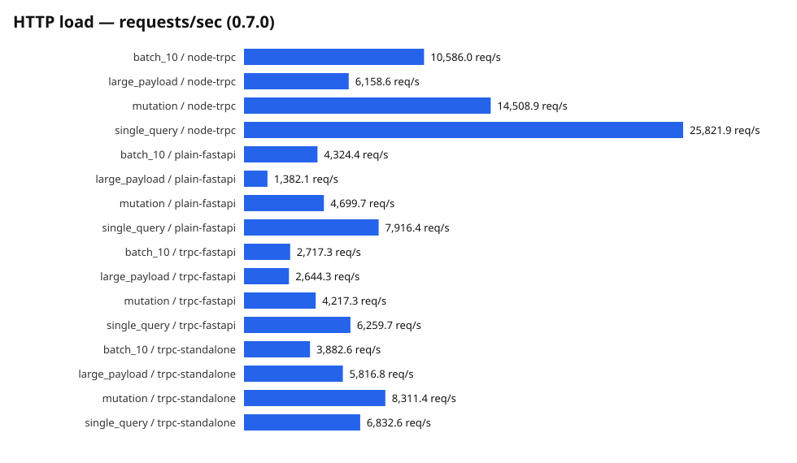

# trpc-rs-py

**The Python backend for your tRPC app.** Define procedures in Python, call
them from your TypeScript app with the official `@trpc/client` — with full
end-to-end types that update live as you edit Python.

```python
# FastAPI — any ASGI framework works; Flask and Django adapters are planned
from collections.abc import AsyncIterator

from trpc_rs_py import Router, tracked

router = Router()

@router.query
def greeting(name: str) -> str:
    return f"Hello {name}!"

@router.mutation
async def create_post(title: str) -> dict:
    return {"id": 1, "title": title}

@router.subscription
async def events() -> AsyncIterator[dict]:
    async for event in stream():
        yield tracked(str(event.id), event.payload)  # resumable SSE ids
```

```ts
// TypeScript — full types, no codegen step in your inner loop
const greeting = await trpc.greeting.query({ name: "Ada" });
//    ^? string
```


> **Status: `1.0.0-beta.1` released — public API frozen; wheels for Linux, macOS, and Windows on PyPI.**
> Queries, mutations, batching, SSE subscriptions, live type sync
> (`trpc-py dev`), typed errors, AI streaming helpers, REST + OpenAPI
> output, CORS/CSRF/rate-limit/auth helpers, a standalone server
> (`trpc-py serve`), a Python client, and starter templates
> (`trpc-py init`) all ship today. See [`MISSION.md`](MISSION.md)
> for the full roadmap and [`docs/feature-matrix.md`](docs/feature-matrix.md)
> for feature status.

## Quickstart

```sh
pip install trpc-rs-py fastapi uvicorn
trpc-py init my-app && cd my-app
uvicorn server:app --reload &
trpc-py dev --app server:router --out web/app-router.d.ts
```

Then `cd web && npm install && npm run dev` — the Next.js app calls Python
with full types that update live on every Python save.

## Why this exists

- **Full end-to-end types** — procedures are typed from Python type hints via
  Pydantic; generated `.d.ts` types update live as you edit Python.
- **AI streaming first-class** — an `async def` generator becomes a typed tRPC
  subscription over SSE; client disconnect cancels the generator (no wasted
  LLM tokens).
- **No lock-in** — the same router can serve REST + an OpenAPI 3.1 document.
- **Fast** — request parsing, routing, batching, and serialization run in a
  Rust core; the Python adapter adds near-zero overhead over a plain JSON view
  ([benchmark results](docs/benchmarks.md)).

## Features

| Feature | One line |
| --- | --- |
| Queries, mutations, batching | tRPC v11 wire-compatible — the official `@trpc/client` works unmodified |
| Subscriptions | `async def` generator → typed SSE stream, `tracked()` ids + `lastEventId` resume |
| Live type sync | `trpc-py dev` rewrites `app-router.d.ts` on every Python save |
| Typed errors | declared `TRPCError` subclasses → discriminated union in TypeScript |
| AI streaming | SSE subscriptions that cancel on disconnect; Vercel AI SDK endpoint helpers |
| TS codegen | `generate_types(router)` → `AppRouter` `.d.ts`; `TypeError`, never `any` |
| Zod codegen | `trpc-py codegen zod` → zod v4 input schemas for frontend form validation |
| REST + OpenAPI | `RestRoute` opt-in serves REST + an OpenAPI 3.1 doc from the same router |
| Middleware + context | onion-chain middleware, `RequestContext`, auth/CORS/CSRF/rate-limit helpers |
| Validation | Pydantic v2 input + output validation on every procedure |
| Standalone server | `trpc-py serve` — Rust (hyper) transport in-process, no uvicorn needed |
| Migration + Python client | `@trpc-rs-py/link` routes ops by path; `create_client` for Python callers |

Per-adapter status with test evidence lives in the
[feature matrix](docs/feature-matrix.md).

## Benchmarks

Latest run (0.8.0, Apple M5 Pro): the standalone Rust server leads plain
FastAPI on writes and large bodies — ~1.4–2.2x across runs, 4,637 vs
2,132 req/s on the 100 KB payload in this one — while the FastAPI mount
stays ~1.8x a plain JSON view on single queries. The official Node
`@trpc/server` still leads on small requests (no input validation in the
reference app).



Full tables, latency percentiles, and methodology:
[docs/benchmarks.md](docs/benchmarks.md).

## Why not FastAPI + OpenAPI codegen?

FastAPI's OpenAPI output plus a client generator (`openapi-typescript`,
Orval, `openapi-generator`) is a legitimate setup — and for pure-REST
APIs it is the right one. Where it falls short for a TypeScript
frontend:

- **Static types.** Client types regenerate on a build step and drift
  silently when the backend moves. `trpc-py dev` rewrites the `.d.ts` on
  every Python save, so a breaking change is a red squiggle, not a CI
  surprise.
- **Request/response only.** No tRPC subscriptions, `lastEventId`
  resume, or call batching — SSE gets hand-rolled per endpoint.
- **No typed errors.** The client sees an HTTP status and an untyped
  detail body; tRPC's error envelope carries a code end-to-end, and
  declared errors arrive as a discriminated union.
- **A generated client, not the official one.** OpenAPI tools emit their
  own fetch wrappers. trpc-rs-py speaks the tRPC v11 wire format, so
  `@trpc/client` and `@trpc/react-query` work unmodified — including
  `subscribe()` and `tracked` event ids.

And it is not a lock-in: opt any procedure into `RestRoute` and the same
router also serves REST plus an OpenAPI 3.1 document for non-TypeScript
clients.

**Stick with FastAPI alone when** there is no TypeScript consumer
(mobile-only, public partner API), the OpenAPI ecosystem is the point
(gateways, contract testing, multi-language codegen), or REST is the
product contract rather than an implementation detail.

## Development

```sh
uv sync --no-install-project   # dev dependencies
uv run maturin develop --release  # build + install the extension
just ci-fast                   # quick gate
just ci                        # full gate
```

See [`AGENTS.md`](AGENTS.md) for contributor/agent rules and
[`CONTRIBUTING.md`](CONTRIBUTING.md) to get started.

## License

MIT — see [`LICENSE`](LICENSE).
