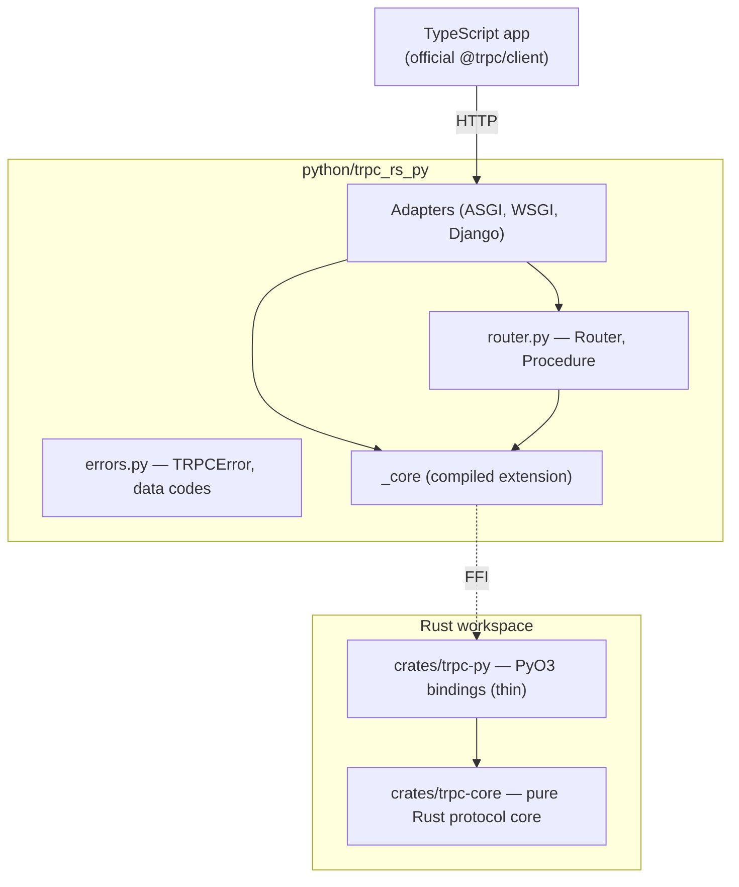
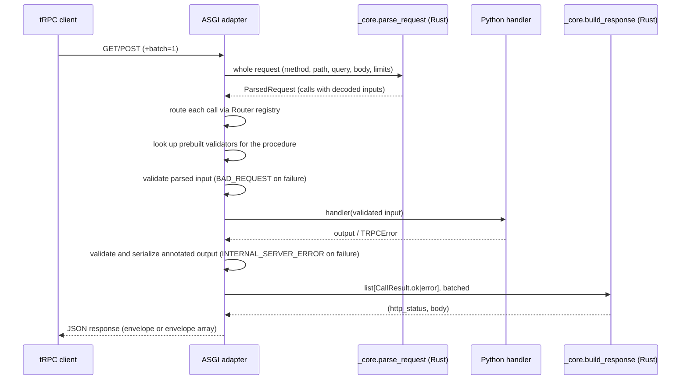
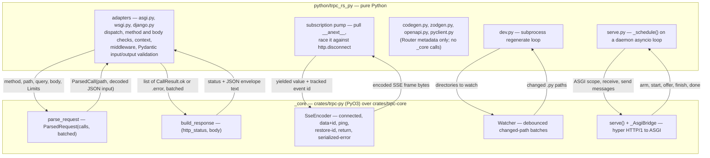
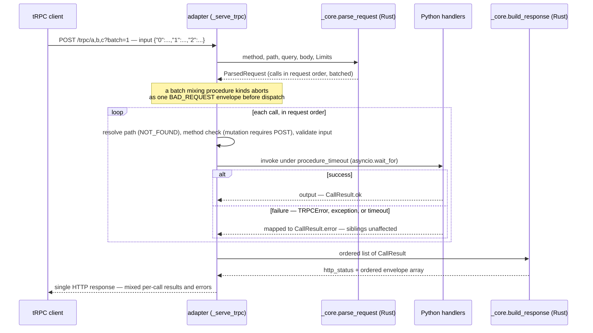
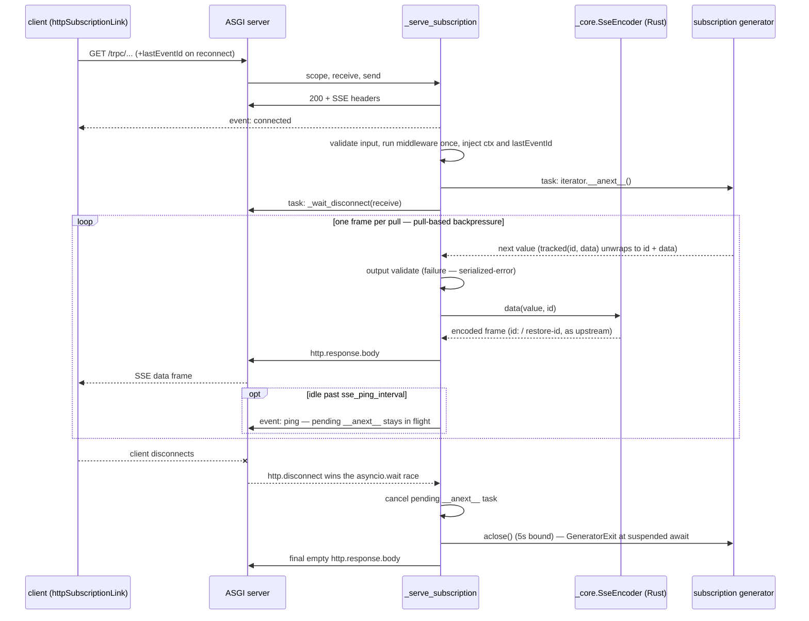
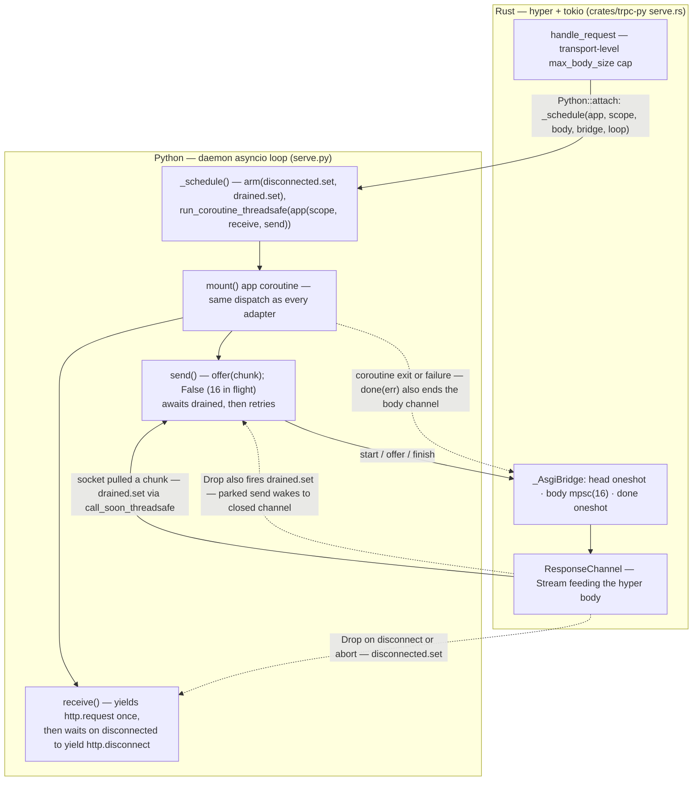
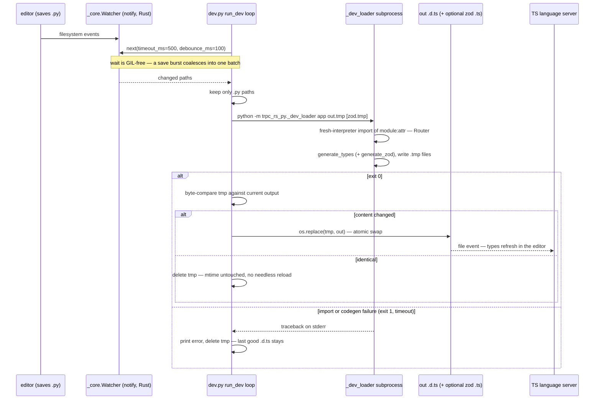
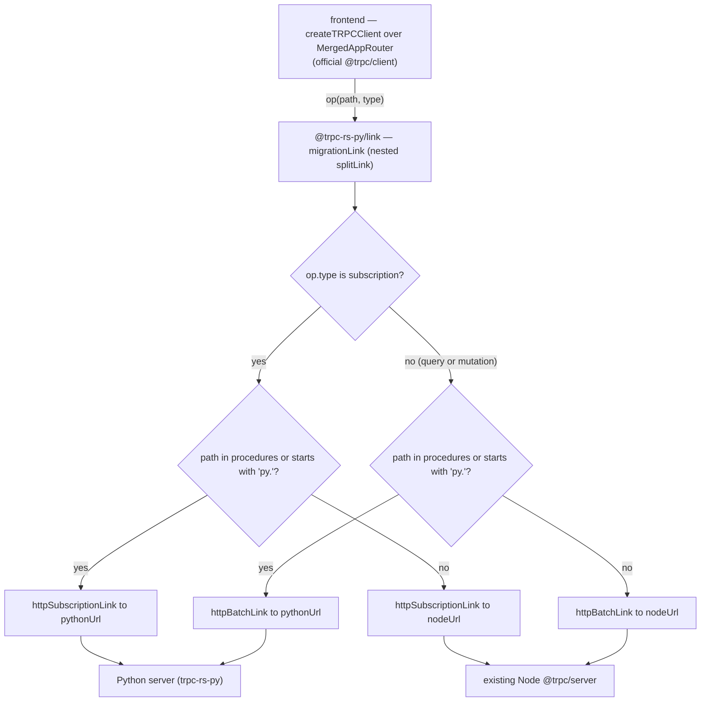

# Architecture

Living document (MISSION.md section 14). Diagrams are Mermaid; this skeleton
grows with each milestone. Current state covers the request path and
batching, subscriptions and cancellation, the FFI boundary, live type sync,
the standalone server bridge, and the migration link.

## Crate and package structure

## Request lifecycle (queries and mutations)

When `mount()` or `attach()` constructs an adapter, it reads registered
procedure annotations and builds Pydantic validators once. Requests then reuse
those validators to check parsed inputs before the Python handler and outputs
after it returns.

## FFI boundary

Everything crossing the Python/Rust line goes through `trpc_rs_py._core`
(`crates/trpc-py`, PyO3 over `crates/trpc-core`): one call per whole request
in, one call per whole response batch out — never per field or per item.
`python_to_json_value` / `json_to_python` convert values at the boundary, and
`Python::detach` releases the GIL around parse, serialize, watcher waits, SSE
frame encoding, and the blocking `serve` loop. Dispatch, input/output
validation, middleware, subscription orchestration, and codegen stay in
Python — the generators (`codegen.py`, `zodgen.py`, `openapi.py`,
`pyclient.py`) read `Router` metadata and never call `_core`.

### Unsafe inventory

`crates/trpc-py` carries `#![deny(unsafe_code)]` at crate level. The only
`unsafe` is the CPython module-initialization entry point generated by the
PyO3 `#[pymodule]` macro, isolated in the `ffi` module of
`crates/trpc-py/src/lib.rs` with a `// SAFETY:` comment at the use site:

| Location | Unsafe use | Justification |
| --- | --- | --- |
| `crates/trpc-py/src/lib.rs`, `mod ffi` (`#[pymodule] fn _core`) | PyO3-generated `PyInit__core` extern entry point | CPython calls it exactly once after loading `_core.so`; required by the extension-module ABI |

The GIL is released with `Python::detach` around the Rust-side parse and
serialize in `parse_request` / `build_response`; only owned Rust data crosses
those scopes. All JSON usage is isolated in `trpc-core/src/json.rs`
(ADR 0002).

## Batching flow

One `parse_request` call decodes the whole batch (`{"0":..,"1":..}` inputs,
comma-separated paths, `?batch=1`). The adapter dispatches each call to its
Python handler, collects `CallResult.ok`/`CallResult.error` in request order,
and one `build_response` call serializes the whole envelope array and selects
the response status. Calls are independent: a missing path, a wrong method, a
validation failure, an exception, or a `procedure_timeout` expiry produces an
error envelope for that call only — siblings still run, and the response is a
single HTTP answer carrying one ordered envelope per call.

## Subscriptions and cancellation

A single unbatched subscription call is answered with an SSE stream (ADR
0007): `connected` first, one data frame per pulled generator item, `ping`
frames on idle when `sse_ping_interval` is set, `return` on a clean end, and
`serialized-error` for failures. Backpressure is pull-based — the adapter
awaits `__anext__`, encodes, and sends before pulling again, so a slow client
never grows a buffer beyond `max_sse_event_size`. Client disconnect
(`http.disconnect`, or a failed `send`) cancels the pending pull and
`aclose()`s the iterator, which throws `GeneratorExit` at the suspended
`await` inside the generator — an in-flight LLM call stops instead of running
unseen.

### Standalone server bridge (`trpc-py serve`)

`serve()` drives the same `mount()` coroutine from a hyper/tokio runtime
(ADR 0013): Rust owns socket I/O, and each request becomes an ASGI scope
scheduled onto a daemon `asyncio` loop via `_schedule()` +
`run_coroutine_threadsafe`, so a tokio worker never parks holding the GIL.
Per request Rust builds an `_AsgiBridge` — a response-head oneshot, a bounded
body channel of 16 chunks, and a done oneshot. A `send` that finds the
channel full awaits the `drained` event, re-armed via
`loop.call_soon_threadsafe` only when a waiter exists. `ResponseChannel`'s
`Drop` (client disconnect, completion, or abort) fires both wake-ups: a
parked `receive` returns `http.disconnect` — cancelling the generator as
above — and a parked `send` wakes to a closed channel and raises
`ConnectionError`. The same bridge serves queries and mutations; it lives in
this section because disconnect-driven cancellation is where its semantics
matter most.

## Live type sync (`trpc-py dev`)

`dev` refuses to run in production, then loops: the Rust `notify` watcher
reports debounced batches of changed paths; each batch regenerates in a fresh
`_dev_loader` subprocess so a save always sees real module state; output goes
to a sibling `.tmp` file that is byte-compared and `os.replace`d only when it
differs — identical output never touches the `.d.ts` mtime, so the TypeScript
language server is not reloaded needlessly. A failed run prints the traceback
and keeps the last good output.

## Migration link routing

`@trpc-rs-py/link` (ADR 0008) is a nested `splitLink` routing each operation:
first by `op.type` (subscriptions stream through `httpSubscriptionLink`;
queries and mutations batch through `httpBatchLink`), then by path — an
explicit `procedures` entry or the `<prefix>.` prefix (default `py.`) goes to
`pythonUrl`, everything else to `nodeUrl`. Paths are never rewritten, so a
migrated procedure keeps its original name. The `MergedAppRouter` type helper
merges the Node and generated Python router types — the Python record wins on
conflicts — so one client sees every procedure typed on both sides.

