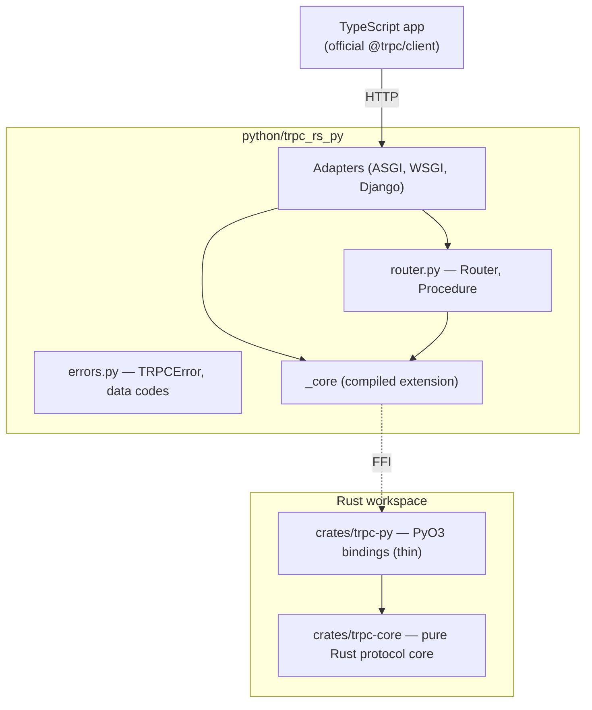
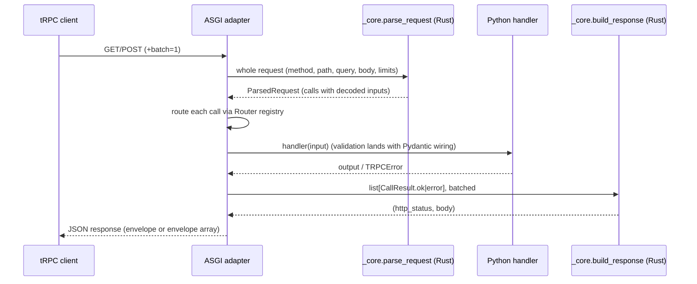

# Architecture

Living document (MISSION.md section 14). Diagrams are Mermaid; this skeleton
grows with each milestone. Current state covers the foundation and the 0.2.0
core-on-FastAPI work in progress.

## Crate and package structure

## Request lifecycle (queries and mutations)

## FFI boundary (unsafe inventory)

`crates/trpc-py` carries `#![deny(unsafe_code)]` at crate level. The only
`unsafe` is the CPython module-initialization entry point generated by the
PyO3 `#[pymodule]` macro, isolated in the `ffi` module of
`crates/trpc-py/src/lib.rs` with a `// SAFETY:` comment at the use site:

| Location | Unsafe use | Justification |
| --- | --- | --- |
| `crates/trpc-py/src/lib.rs`, `mod ffi` (`#[pymodule] fn _core`) | PyO3-generated `PyInit__core` extern entry point | CPython calls it exactly once after loading `_core.so`; required by the extension-module ABI |

The GIL is released with `Python::detach` around the Rust-side parse and
serialize in `parse_request` / `build_response`; only owned Rust data crosses
those scopes. All JSON usage is isolated in `trpc-core/src/json.rs`
(ADR 0002).

## Batching flow

One `parse_request` call decodes the whole batch (`{"0":..,"1":..}` inputs,
comma-separated paths, `?batch=1`). The adapter dispatches each call to its
Python handler, collects `CallResult.ok`/`CallResult.error` in request order,
and one `build_response` call serializes the whole envelope array and selects
the response status.

## Later sections (planned)

Subscription and cancellation flow (0.3.0), live type sync flow (0.3.0),
migration link routing (0.4.0), standalone server path (0.7.0).
