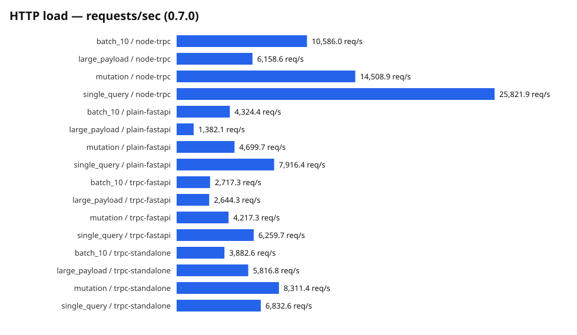
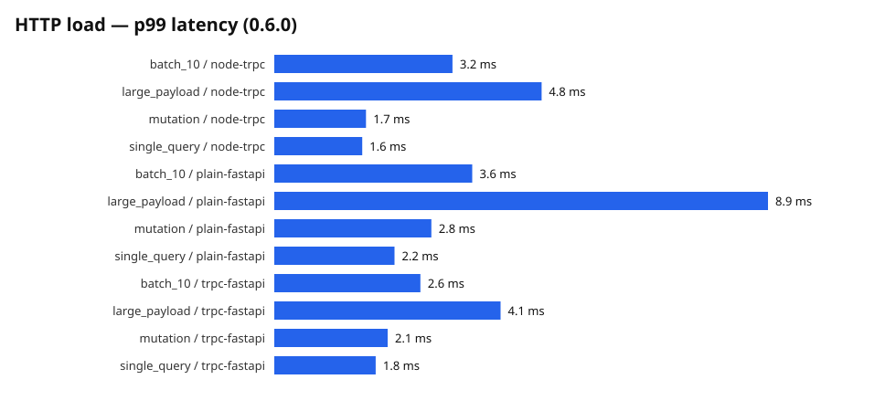
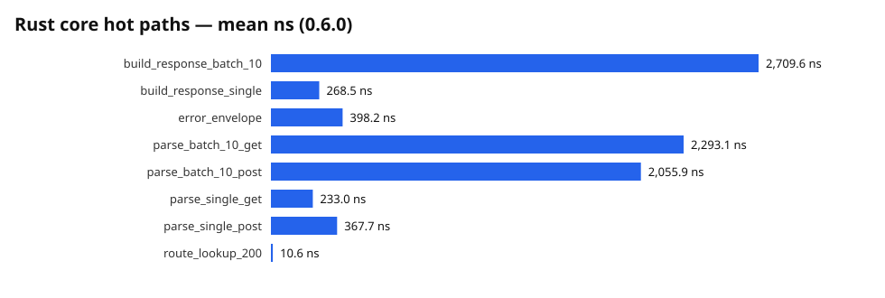

# Benchmarks

Latest run: **0.5.0** (see `benchmarks/results/0.5.0/` for the raw JSON —
numbers are machine-produced by criterion, pytest-benchmark and oha, never
hand-edited). Method, environment and tuning knobs are documented in
[`benchmarks/README.md`](https://github.com/Seyamalam/trpc-rs-py/blob/main/benchmarks/README.md).

Environment: Apple M5 Pro (arm64), macOS, Python 3.14.7, rustc 1.96.0,
Node 26.7.0, oha 1.16.0. All servers ran single-worker on localhost with a
readiness probe before each load run; workloads ran for 5s at 16 connections.
No input validation ran on any server so the comparison isolates protocol and
adapter overhead.

## HTTP load (oha)

Four workloads per server: a single query, a 10-call batch in one HTTP
request, a mutation, and a 100 KB payload.

| Server | single query | batch of 10 | mutation | 100 KB payload |
| --- | --- | --- | --- | --- |
| trpc-fastapi | 15,079 req/s (p99 2.13 ms) | 10,838 req/s (p99 2.78 ms) | 13,992 req/s (p99 2.20 ms) | 6,522 req/s (p99 3.11 ms) |
| plain FastAPI | 11,808 req/s (p99 1.89 ms) | 9,108 req/s (p99 2.99 ms) | 10,771 req/s (p99 2.48 ms) | 3,161 req/s (p99 7.66 ms) |
| Node `@trpc/server` | 35,117 req/s (p99 1.08 ms) | 16,571 req/s (p99 2.26 ms) | 30,677 req/s (p99 1.27 ms) | 9,938 req/s (p99 3.28 ms) |

Reading: the tRPC mount is **~28% faster than a plain FastAPI JSON view** on
the single-query workload and ~2x on large payloads, because request parsing
and serialization happen in the Rust core. The official Node standalone
adapter is still ~2.3x faster on small requests — Python handler dispatch
dominates there, which is the expected gap for a Python-served API.

## Adapter micro-benchmarks (pytest-benchmark)

| Benchmark | mean |
| --- | --- |
| tRPC query through the ASGI mount | 511.7 µs |
| Plain JSON view baseline | 555.6 µs |
| tRPC query through `mount_wsgi()` (Flask) | 1,535.7 µs |
| tRPC query through `trpc_view()` (Django) | 1,604.0 µs |
| `generate_types`, 10 procedures | 139.4 µs |
| `generate_types`, 50 procedures | 685.8 µs |
| `generate_types`, 200 procedures | 2,795.0 µs |

At the micro level the ASGI adapter overhead is within noise of a plain JSON
view. The WSGI and Django adapters cost roughly **1 ms per request** on top —
that is the price of the pumped event loop and worker-thread bridge that lets
the shared ASGI dispatch (including SSE streaming) run inside a synchronous
framework; see [adapters](adapters.md) for the operational limits this implies.
Codegen scales roughly linearly — ~2.8 ms for a 200-procedure router — which
leaves large headroom under the 1-second save-to-`.d.ts` target that
`trpc-py dev` (shipped in 0.3.0) operates under.

## Rust core hot paths (criterion)

| Benchmark | mean |
| --- | --- |
| `route_lookup_200` | 7.7 ns |
| `parse_single_post` | 179.4 ns |
| `parse_single_get` | 238.0 ns |
| `parse_batch_10_post` | 1,951.4 ns |
| `parse_batch_10_get` | 2,136.6 ns |
| `build_response_single` | 213.4 ns |
| `build_response_batch_10` | 2,097.7 ns |
| `error_envelope` | 382.4 ns |

Protocol parsing and serialization are nanosecond-scale; per-request cost is
dominated by HTTP handling and Python dispatch, not the protocol core.

## Deferred until the features exist

- SSE / streaming-subscription load: benchmarks for long-lived streams
  (throughput per client, memory per connection) are planned for a later
  milestone; subscriptions shipped in 0.3.0 with functional coverage.
- Rust-side codegen benches: codegen is Python today.
- Pure-Python protocol comparison: lands with the 0.7.0 performance pass.
- WSGI/Django HTTP-load baselines (oha against a real server): the adapter
  micros above measure in-process dispatch; a loaded-server comparison lands
  with the 0.7.0 performance pass.
